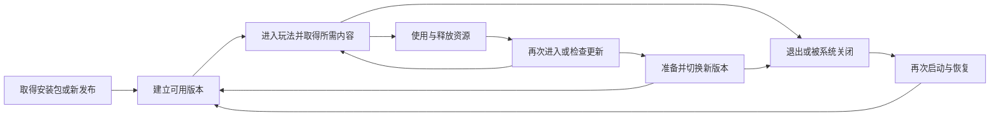

# 资源业务场景校验入口

本入口用于设计评审、人工验收和代码审查时选择业务场景。它覆盖安装、发布、更新、中断恢复、进入玩法后下载、资源使用与长期运行。每项以“前提—业务动作—可观察结果”描述，不规定实现方式，不包含测试脚本。

**表中的期望是验收目标，不代表当前实现已通过。** 已知问题及实现证据见 [资源系统问题审计](../../../Docs/AssetIssueAudit.md)。[资源系统设计](AssetSystemDesign.md) 第 12 节给出 DEC 策略的设计评审口径；实际校验须记录所采用的策略版本。未经选定的策略及没有数值的预算记录“待确定”，不能擅自判通过或失败。

## 1 从哪里开始

| 本次要检查的业务 | 首选章节 | 必须叠加的章节 |
|---|---|---|
| 新用户安装与进入游戏 | 首次安装 | 故障、资源依赖、平台生命周期 |
| 老用户安装新应用 | 覆盖安装 | 已准备更新、后下载、混合场景 |
| 发布一个新资源版本 | 构建与发布、在线更新 | 来源一致性、发布中断、旧玩家后下载 |
| 更新下载或生效时退出 | 下载中断、版本恢复 | 已准备更新、覆盖安装、故障 |
| 进入活动、关卡或页面下载内容 | 使用时下载、按组预下载 | 多消费者、资源使用、依赖与卸载 |
| 修改加载、缓存或清理规则 | 资源使用、依赖与卸载 | 多消费者、混合场景、长期容量 |
| 上线移动端、浏览器或小游戏 | 平台生命周期 | 首次安装、下载中断、版本恢复、故障 |
| 修复一条已知问题 | 对应业务场景 | 同章正常路径、同类失败、再次请求和混合场景 |

执行时先确定所用安装包、原可用版本、目标版本、哪些内容已下载、哪些内容正在使用，再选中相关场景。所有适用场景都需要实际结果；“不适用”要写业务原因，不能只因当前实现没有能力而排除。

## 2 统一业务词汇与基本要求

- **随包内容**：安装应用时已提供，正常情况下使用它不需要网络。
- **启动必需内容**：进入相应游戏阶段前必须取得完整内容。
- **使用时下载内容**：首次进入相关玩法或页面时才取得，未使用时允许缺少。
- **可用版本**：游戏当前已经确认可使用的一整套内容。
- **已收到内容**：下载已结束，但可能尚未属于当前可用版本。
- **已准备更新**：目标内容已准备好，因旧内容仍在使用等原因，需要再次启动才能生效。
- **保留策略**：覆盖安装时尽量沿用仍适用的已下载内容。
- **覆盖策略**：覆盖安装按新安装内容替换或移除旧内容。

每个场景都遵守以下底线：不能混用互不兼容的新旧内容；不能把未完成、缺失或损坏内容报告为成功；一个页面的取消或释放不能破坏另一个有效消费者；旧结果晚到不能改变已经失效的目标；失败应有明确结果和已约定的恢复方式。

## 3 场景维度与组合覆盖

同一版本号不能替代内容是否一致的判断；应用升级与资源更新是两个独立变化。已下载与正在使用也是两个独立状态。

| 维度 | 必须覆盖的业务取值 |
|---|---|
| 安装历史 | 首装、同包覆盖、新包覆盖、重装保留资料、重装清除资料 |
| 版本关系 | 内容相同、向前更新、允许回退、不允许回退、应用不兼容 |
| 内容分发 | 随包、启动必需、使用时下载；保留或覆盖策略 |
| 内容状态 | 未下载、下载中、已收到未生效、已可用、正在使用、已释放、缺失或损坏 |
| 本次变更 | 新增、删除、内容、导入效果、访问位置、分组、依赖、加密或分发方式变化 |
| 中断时点 | 检查前后、取得资料、取得内容、已准备、正在生效、已生效、清理、再次恢复 |
| 消费者 | 单页面、多页面、重复请求、一个退出、全部退出、尚未接收结果 |
| 外部条件 | 在线、离线、切网、超时、空间不足、写入受限、来源替换、应用退出、平台清理 |
| 运行规模 | 少量内容、大量历史内容、多轮更新、长期反复进入退出 |

组合规则：每个新增、修改或删除内容，分别考虑“未下载、已下载、正在下载、正在使用”；每个中断场景，分别考虑“原版本可用、原版本不完整、已准备另一更新”；每个共享请求，覆盖“先退出的一方、后接收的一方、全部退出”；再叠加同包与不同依赖、同版本与变化版本。不能只校验一次成功路径。

## 4 构建与发布

| 编号 | 前提 | 业务动作 | 期望结果 |
|---|---|---|---|
| PUB-01 | 线上有旧版，本地修改了内容 | 选择构建并发布，构建成功 | 新版真实发布，玩家可以检查到；结果明确成功 |
| PUB-02 | 已有一次成功构建产物 | 只发布已有产物，不重新构建 | 发布指定产物，不依赖是否刚执行构建 |
| PUB-03 | 合法新版已准备 | 发布时断网、接口拒绝或缺上传文件 | 明确失败，不能将任务结束当成发布成功 |
| PUB-04 | 已上线多个内容包 | 只删除一个包或整个活动后增量发布 | 玩家更新后不再查到已下线内容，其他内容不变 |
| PUB-05 | 已有按组预下载内容 | 只增加、删除或移动分组 | 新分组规则生效，不因资源字节未变而漏发 |
| PUB-06 | 玩法内容原来使用时下载 | 改为启动前必需后发布 | 新时机生效；相同已下载内容按复用规则处理 |
| PUB-07 | 内容原来随安装包提供 | 改为远端提供，或反向修改 | 安装及获取方式一致，不能要求不存在的随包内容 |
| PUB-08 | 应用升级沿用相同素材，或只改覆盖策略 | 构建并发布 | 新应用与覆盖规则真实生效，不能沿用过期版本说明 |
| PUB-09 | 图片源素材不变 | 只改压缩、颜色或平台导入设置后发布 | 玩家看到新设置对应的显示效果 |
| PUB-10 | 音频或其他素材源内容不变 | 只改导入、播放或平台设置后发布 | 玩家使用新设置对应的内容 |
| PUB-11 | 内容与身份不变，访问位置调整 | 单独改名或移动目录；另测同时更新其他内容 | 新入口可用，旧入口按规则退出，资料与实际内容一致 |
| PUB-12 | 本机有旧成功产物 | 本轮构建失败，仍选择发布 | 发布停止，线上不变，不能发布旧产物冒充本轮成功 |
| PUB-13 | 新内容未正常产出 | 构建失败后排除问题，再做增量构建 | 能重新形成正确产物，失败不被记为已成功 |
| PUB-14 | 角色和共享材质采用不同压缩方式 | 构建、发布、加载，再单独更新材质 | 依赖和显示正常，共享素材符合设计 |
| PUB-15 | 角色变化，依赖素材未变 | 增量构建并发布，再更新依赖素材 | 与全量构建的业务效果一致，不夹带过期依赖 |
| PUB-16 | 内容上传完，最后发布阶段仅部分完成 | 再发布同一版本 | 能补完玩家更新入口和发布状态，不因部分记录成功而跳过 |
| PUB-17 | 资料已上传，但服务器生效动作失败 | 重试发布，玩家再次检查 | 发布结果反映失败；重试可使目标真实生效 |
| PUB-18 | 当前线上版本仍有玩家使用 | 并发发布两版，或发布中途撤销 | 对外只有明确可用发布；结果与当前线上版本一致 |
| PUB-19 | 本次发布曾生效，但响应丢失，随后另一发布生效 | 查询本次发布结果 | 区分本次是否生效与目前哪版在线，不把两次发布混为一件事 |

## 5 首次安装

| 编号 | 前提 | 业务动作 | 期望结果 |
|---|---|---|---|
| INS-01 | 完整安装包，无本地历史资料 | 在线首次启动 | 使用正确初始版本，必要内容准备好后进入 |
| INS-02 | 只有随包内容需要使用 | 离线首次启动并进入这些页面 | 不因无网络拒绝完整随包内容 |
| INS-03 | 安装包含使用时下载的玩法 | 首次直接进入玩法，尚未检查更新 | 按 DEC-07 能取得所需内容，或明确先准备版本；不能把合法玩法当未知 |
| INS-04 | 有启动必需远端内容 | 离线首次启动 | 明确说明必需内容未就绪及恢复途径，不进入缺内容阶段 |
| INS-05 | 随包角色使用远端共享素材 | 首次加载角色 | 按联网政策取得完整依赖，或明确未就绪，不交付缺材质角色 |
| INS-06 | 全部玩法都要求使用时下载 | 首次启动并选择一个玩法 | 合法玩法和获取规则可被识别，不形成空版本却报告全部准备成功 |
| INS-07 | 多个页面同时等待首次准备 | 同时启动或再次点击进入 | 使用同一次明确结果，不重复相互覆盖版本 |
| INS-08 | 安装包缺必需内容或版本资料损坏 | 首次启动 | 明确失败及修复途径，不把损坏当作正常空内容 |
| INS-09 | 首次保存因空间或系统故障失败 | 排除故障，在同一次运行内重试 | 可以成功准备并进入，无需被迫重启 |
| INS-10 | 首次准备尚未结束 | 返回后台或关闭后重新启动 | 最终建立完整可用版本，没有半初始化结果 |

## 6 覆盖安装与重新安装

| 编号 | 前提 | 业务动作 | 期望结果 |
|---|---|---|---|
| OVR-01 | 已有完整本地版本 | 覆盖安装完全相同安装包 | 保留有效内容，正常启动，不无故重复获取 |
| OVR-02 | 应用版本号相同，安装内容实际变化 | 覆盖安装后启动 | 按实际安装内容处理，不仅依据版本号沿用旧事实 |
| OVR-03 | 应用版本升级，素材实际相同 | 覆盖安装后在线及离线启动 | 使用兼容版本，复用符合策略的相同内容 |
| OVR-04 | 本地热更内容比安装包更新 | 覆盖安装旧或较早安装包 | 按兼容与回退政策 DEC-08/09 处理，不混装 |
| OVR-05 | 已下载多个远端活动，均未变化 | 新安装包采用保留策略 | 按 DEC-08 沿用可复用活动，不因只看见随包内容而失去访问能力 |
| OVR-06 | 已下载活动中一部分变化 | 覆盖安装并依次进入各活动 | 未变内容按策略保留，变化内容获取新版本 |
| OVR-07 | 旧安装包含某玩法，新安装删除它 | 覆盖安装并访问旧入口 | 按新规则不可访问，不能靠旧缓存继续报告存在 |
| OVR-08 | 旧内容应按覆盖策略处理 | 覆盖安装后离线及在线使用 | 替换或移除结果明确，不错误保留旧规则 |
| OVR-09 | 同轮存在保留和覆盖两类内容 | 覆盖安装 | 两类分别遵守策略，互不影响共享依赖 |
| OVR-10 | 本地内容缺失或损坏 | 覆盖安装完整新包 | 按 DEC-02 提供修复入口并恢复兼容版本，不把旧损坏误判为新包也坏 |
| OVR-11 | 重新安装，系统保留旧资料 | 启动新应用 | 按兼容政策识别历史资料，不能把它误当全新或当前版本 |
| OVR-12 | 卸载后全部本地资料已清除 | 重新安装 | 按首次安装工作，不依赖已不存在的历史下载 |

## 7 在线更新

| 编号 | 前提 | 业务动作 | 期望结果 |
|---|---|---|---|
| UPD-01 | 当前版本完整且与发布一致 | 检查更新 | 明确无变化，不额外切版或重复下载 |
| UPD-02 | 版本名称相同，但标签或规则变化 | 检查并完成更新 | 按完整资料变化生效，不能仅凭名称跳过 |
| UPD-03 | 有新增启动必需内容 | 更新 | 必需内容及完整依赖取得后才完成切换 |
| UPD-04 | 只有未使用的可选内容新增或变化 | 更新，不进入这些玩法 | 资料可识别，新版可用；纯可选内容按时机获取 |
| UPD-05 | 某活动被删除 | 更新后查询并进入旧活动 | 旧入口退出，不交付不再属于当前版本的内容 |
| UPD-06 | 内容从使用时下载改为启动必需 | 更新 | 补齐缺失内容再完成，已拥有的相同内容可复用 |
| UPD-07 | 启动必需内容改为使用时下载 | 更新 | 获取时机按新规则，已有相同内容不必强制丢弃 |
| UPD-08 | 内容的依赖增加、删除或替换 | 更新后进入内容 | 使用完整新依赖，不能遗漏或保留不再适用的组合 |
| UPD-09 | 获取方式或加密方式改变 | 更新后使用内容 | 能正确使用新版，不误复用无法读取的旧内容 |
| UPD-10 | 素材相同，仅分组规则变化 | 更新时仍有页面使用或等待素材 | 正在使用内容持续正确；旧等待可明确失效并重试，不交付空资源 |
| UPD-11 | 服务端明确要求升级应用 | 检查更新 | 明确升级要求，停止不适用资源获取 |
| UPD-12 | 发布内容与应用不兼容，未提前提示升级 | 检查更新 | 在大量获取前明确拒绝原因，原完整版本继续可用 |
| UPD-13 | 版本资料与发布相同，但必需内容丢失或损坏 | 检查并完成同版修复 | 补齐必需内容及依赖，区分修复与无变化，不谎报已经完整 |
| UPD-14 | 服务器将资源回退到较早版本 | 在线更新 | 按 DEC-09 接受完整兼容回退或明确拒绝，不混用两版 |

## 8 下载中断与再次请求

| 编号 | 前提 | 业务动作 | 期望结果 |
|---|---|---|---|
| INT-01 | 正在检查目标或取得版本资料 | 断网后重试 | 失败明确，可重新规划，不把不完整资料当成删除 |
| INT-02 | 一个内容只取得一部分 | 关闭后再次更新 | 不把半份内容当成功；按 DEC-01 重新取得或可靠继续 |
| INT-03 | 部分内容完整收到，但更新未生效 | 重启后再次更新同版 | 旧正式版本不变；复用范围符合 DEC-01，重新获取量可解释 |
| INT-04 | 部分内容已收到，服务器又发布下一版 | 重启后更新 | 从当前可用版本规划，只复用能证明适用的内容 |
| INT-05 | 更新途中一个内容失败 | 继续等待或重试 | 不提前宣称整版成功；有效完成材料按规则保留 |
| INT-06 | 多个页面等待同一更新 | 一个页面取消 | 其他页面继续；退出页面不再接收业务结果 |
| INT-07 | 最后一方取消，旧请求尚未结束 | 立即重新请求 | 新请求不继承上一方的取消失败 |
| INT-08 | 一次中断恢复尚未完成 | 再中断，再启动 | 可以重复恢复，最终只有完整旧版或完整新版 |

## 9 生效中断与版本恢复

| 编号 | 前提 | 业务动作 | 期望结果 |
|---|---|---|---|
| REC-01 | 新内容取得，但版本尚未生效 | 强制关闭再启动 | 使用完整旧版，或按已准备政策继续，不混入部分新版 |
| REC-02 | 系统正在保存新版为可用版本 | 强制关闭再启动 | 只选择经完整确认的旧版或新版 |
| REC-03 | 新版已生效，收尾未结束 | 立即关闭再启动 | 保留已生效新版，不误退回旧版 |
| REC-04 | 最近一次保存不完整，但仍有完整旧版 | 再次启动 | 正确选择可用事实，不相信损坏的最新记录 |
| REC-05 | 需恢复旧版，独立恢复材料完整 | 离线启动 | 可以恢复，不依赖最新服务器 |
| REC-06 | 恢复旧版期间又被关闭 | 再次启动 | 可重复完成恢复，不丢掉唯一恢复机会 |
| REC-07 | 版本完整，系统暂时无法清理旧记录 | 再次启动或重试 | 按 DEC-04 处理；清理失败不能被误描述为内容损坏 |
| REC-08 | 正式版本不完整，恢复材料也坏了 | 启动 | 进入 DEC-02 修复选择，不静默宣布成功 |
| REC-09 | 版本或恢复资料格式损坏 | 启动后选择修复 | 明确原因与可行操作，不无限等待 |
| REC-10 | 首次保存失败，尚无可用历史版本 | 排除故障后同次运行重试 | 能重新建立初始版本，不遗留无法解除的失败状态 |
| REC-11 | 新版已经完整保存，成功提示尚未出现 | 强制关闭并重启 | 使用完整保存的新版，不因尚未看到成功提示而退回旧版 |
| REC-12 | 版本已完整保存，仅短暂读取失败 | 排除系统故障后同次运行重试 | 可以读取既有完整版本，不把读取失败当成从未保存 |
| REC-13 | 首次保存失败后留下损坏版本资料 | 排除故障后启动或修复 | 按 DEC-02 处理损坏资料，不与尚未保存任何版本的重试混淆 |
| REC-14 | 最新保存版本完整但暂时无法读取，较旧版本仍可读取 | 启动并在故障解除后重试 | 明确暂时无法确认，不把读取故障静默解释成旧版本成功 |

## 10 已准备但需再次启动的更新

| 编号 | 前提 | 业务动作 | 期望结果 |
|---|---|---|---|
| RST-01 | 正在使用的素材发生变化 | 下载完整更新 | 明确告知已准备、需重启；当前仍用整套旧内容 |
| RST-02 | 已准备更新 | 离线重新启动 | 目标完整且兼容时正常生效 |
| RST-03 | 已准备某版 | 再次检查到同一目标 | 重用已有准备状态，不重复获取已准备完整内容；必要版本检查仍可进行 |
| RST-04 | 已准备某版，又发现不同目标 | 再次检查 | 明确已有目标及替换规则，不偷偷覆盖 |
| RST-05 | 玩家决定放弃尚未生效的更新 | 放弃后继续游戏，再检查更新 | 旧可用版本保持，之后可正常准备 |
| RST-06 | 已准备更新，随后仅补齐旧版另一活动 | 下载活动，再离线重启 | 目标所需内容完整时生效；新活动的目标内容不足时按策略保留当前完整版本并提示待补齐 |
| RST-07 | 已准备更新，当前使用者全部退出 | 清理闲置资源并再次操作 | 是否立刻生效按已约定时机；不能把仍待重启误报为已更新 |
| RST-08 | 已准备材料损坏，旧版完好 | 重启 | 按 DEC-03 提供继续旧版或重新准备的选择 |
| RST-09 | 已准备资料本身无法识别 | 重启或选择修复 | 明确失败/作废规则，当前完整版本不被损坏目标覆盖 |
| RST-10 | 已准备旧目标，随后覆盖安装新包 | 启动 | 按 DEC-08/09 处理兼容性，旧目标不能覆盖新事实；材料也损坏时再关联 DEC-03 |
| RST-11 | 待重启版已经生效，旧准备记录尚未清理 | 立即关闭并再次启动 | 继续使用已生效新版，不重复准备或再次要求重启 |
| RST-12 | 已准备更新后又下载了目标中会变化的活动 | 继续当前版本，再次查看更新状态 | 所需内容与新下载活动一致；不足时明确待补齐，不能继续宣称全部准备完成 |
| RST-13 | 玩家曾放弃或替换准备目标，之后最近保存资料损坏 | 从可恢复旧状态启动 | 不自动重新执行已可能被放弃的旧目标，明确需要重新确认 |

## 11 进入玩法后下载

| 编号 | 前提 | 业务动作 | 期望结果 |
|---|---|---|---|
| LATE-01 | 合法玩法尚未下载 | 首次进入 | 获取当前版本内容及完整依赖后显示 |
| LATE-02 | 内容已经下载且未变 | 再次进入 | 复用相同可用内容，不无故重下 |
| LATE-03 | 已下载可选内容发生更新 | 更新后再次进入 | 获取新版，不使用过期旧内容 |
| LATE-04 | 从未下载的可选内容已更新 | 首次进入 | 直接取得当前新版，不先下载旧版 |
| LATE-05 | 内容未变，共享依赖变化 | 进入内容 | 取得适用依赖，组合完整 |
| LATE-06 | 一个内容已取得，另一个依赖失败 | 再次进入 | 补齐缺失项，失败不伪装为可用内容 |
| LATE-07 | 多个玩法共用素材 | 同时进入 | 同一适用素材可共享获取，各玩法结果完整 |
| LATE-08 | 玩家关闭页面 | 下载晚到 | 不重新打开页面或创建已不需要的对象 |
| LATE-09 | 内容获取中，主版本切换且该内容变化 | 等旧结果到达 | 旧内容不能覆盖新版，旧请求明确结束或重试 |
| LATE-10 | 主版本变化，但目标内容仍完全相同 | 继续等待与再次请求 | 按目标有效性处理，最终可取得当前适用内容 |
| LATE-11 | 玩家关闭自动获取，内容缺失 | 进入玩法或尝试本地获取 | 明确未就绪，不偷偷发起网络 |
| LATE-12 | 不合法路径或已下线玩法 | 请求进入 | 明确不存在，不猜测远端下载位置 |
| LATE-13 | 合法内容缺失，但获取服务尚未就绪或暂不可用 | 进入玩法，服务恢复后重试 | 明确未就绪，可重新获取，不永久等待或把合法内容当未知 |
| LATE-14 | 已下载玩法仍存在，但发布时重新组织了资源包 | 更新后离线进入该玩法 | 按已采用的保留策略维持玩法完整，不因分包变化漏掉所需内容 |

## 12 按组预下载

| 编号 | 前提 | 业务动作 | 期望结果 |
|---|---|---|---|
| TAG-01 | 分组存在且全部内容已具备 | 预下载该组 | 立即确认完成，不重复获取 |
| TAG-02 | 分组存在但部分内容缺少 | 预下载 | 取得整组及跨组依赖，完成范围明确 |
| TAG-03 | 一个合法空分组与一个不存在分组 | 分别预下载 | 区分空组完成与未知分组失败 |
| TAG-04 | 预下载中分组被删除 | 更新后继续等待 | 旧目标明确失效，不无限等待 |
| TAG-05 | 预下载中分组加入、移出内容 | 更新 | 按新闭包明确结束或重建，不误报旧目标满足新组 |
| TAG-06 | 其他内容更新，目标组内容与依赖不变 | 继续预下载 | 允许按相同目标继续，不能误混新内容 |
| TAG-07 | 分组内容表面不变，但共享依赖变化 | 更新 | 按完整依赖变化判断目标，不漏新依赖 |
| TAG-08 | 多个组共享内容 | 取消其中一组，再等待另一组 | 另一组继续完整取得，失败和进度各自明确 |

## 13 资源获取与结果接收

| 编号 | 前提 | 业务动作 | 期望结果 |
|---|---|---|---|
| USE-01 | 资源及依赖完整、本地可立即使用 | 同步取得 | 返回正确对象 |
| USE-02 | 随包读取尚未就绪或内容需网络 | 同步取得 | 返回明确未就绪，不阻塞等待网络，不破坏异步获取 |
| USE-03 | 同路径异步获取尚未完成 | 另一页面同步取得 | 不包装成永久为空的有效资源 |
| USE-04 | 上次获取因网络或读取失败 | 排除故障，再请求 | 可正常重试，不一直复用旧失败 |
| USE-05 | 上次失败结果仍在页面缓存 | 再同步获取相同内容 | 明确失败或取得成功新结果，不能返回有效空资源 |
| USE-06 | 目录或页面中一项曾失败 | 再批量获取 | 新成功结果生效，旧失败缓存不能遮挡它 |
| USE-07 | 多资源混合成功、失败和缺失 | 批量获取并接收结果 | 成功项正确；失败项有明确结果，不以数量或空对象伪装全成功 |
| USE-08 | 请求资源类型与实际内容不符 | 接收结果 | 明确不可用，不以“存在引用”冒充正确类型 |
| USE-09 | 取得结果后资源为空或显示依赖丢失 | 页面展示 | 不能仍宣布资源成功有效；失败可诊断 |
| USE-10 | 两方同资源请求均已完成，但 B 尚未接收 | A 接收后释放，再由 B 接收 | B 仍取得自己的有效结果 |
| USE-11 | A 已使用资源，B 新请求尚未接收 | A 退出，B 随后接收 | A 释放不破坏 B 的占用 |
| USE-12 | 页面发起请求后立即关闭 | 放弃接收，稍后重新进入 | 有明确退出请求的方式，资源不长期无主占用 |
| USE-13 | 同一请求已成功接收一次 | 再次查看结果，然后只释放自己的资源 | 结果和占用规则一致，不重复增加或丢失所有权 |
| USE-14 | 请求已完成但未接收，所属游戏会话关闭并重建 | 再查看旧请求结果 | 明确旧请求不可用，不交付旧资源、不重新建立旧占用 |
| USE-15 | 同一请求的资源已经领取 | 再次尝试领取并关闭该请求 | 明确已领取；关闭请求不释放已经交给使用方的资源 |

## 14 依赖与资源清理

| 编号 | 前提 | 业务动作 | 期望结果 |
|---|---|---|---|
| DEP-01 | 随包内容依赖远端素材 | 首次使用 | 完整依赖可识别，按联网政策准备后使用 |
| DEP-02 | 多级、跨组或循环共享依赖 | 加载与退出玩法 | 无无限等待；全部必要素材完整，退出可收束 |
| DEP-03 | 角色 A、B 同包，只有 A 使用外部材质 | 保留 B，退出 A，清理闲置资源 | 不销毁仍被驻留内容引用的材质 |
| DEP-04 | 上一场景清理后 | 再次进入 A | 角色材质完整，不返回已损坏的旧对象 |
| DEP-05 | 多个父内容共用一个素材 | 逐个退出，仅保留最后一个 | 共享素材持续可用，最后退出后才符合清理条件 |
| DEP-06 | 依赖内容自身也被单独使用 | 退出依赖页面，但保留父内容 | 父内容的显示和再次获取不受影响 |
| DEP-07 | 同一素材在多个内容中共享 | 全量与增量发布后分别使用 | 共享关系一致，不产生不应存在的重复或过期内容 |
| DEP-08 | 部分内容等待读取，部分已在使用 | 清理闲置资源或释放一个消费者 | 有效在途与在用资源保留，无主内容可退出 |
| DEP-09 | 角色已生成实例，生成页面准备退出 | 将资源归属交给实例，再释放页面占用 | 实例及其材质持续可用，实例退出后其占用收束 |
| DEP-10 | 对象池仍保留可再次使用的角色 | 退出当前玩法并清理闲置资源，再从池中取出角色 | 池中对象的依赖仍完整；清空池后可释放对应占用 |

## 15 多个请求、取消与再次请求

| 编号 | 前提 | 业务动作 | 期望结果 |
|---|---|---|---|
| CON-01 | 多个页面请求相同版本相同内容 | 同时加载 | 可共享获取，各自收到独立明确结果 |
| CON-02 | 多方共享内容 | 一方取消或关闭 | 其他方继续，不继承它的取消 |
| CON-03 | 结果已完成但各方接收时刻不同 | 先接收者用完释放 | 未接收者仍持有自己的接收机会 |
| CON-04 | 多方退出，仅剩最后一方 | 最后一方也退出 | 获取能收束，晚到结果不安装到失效目标 |
| CON-05 | 最后一方退出后底层仍在结束 | 再请求同一内容 | 新需求正常处理；旧请求不能误取消或删除新需求 |
| CON-06 | 获取版本来源时取消尚未结束 | 立即重试 | 不继承旧来源取消失败 |
| CON-07 | 多个页面同时检查更新 | 一个取消，其他等待 | 剩余消费者可完成，目标不会被取消者改动 |
| CON-08 | 同一有效来源部分获取失败 | 重试相同玩法 | 能复用已确认完成内容，只补齐不足 |
| CON-09 | 完成通知中立即发起新请求或释放旧资源 | 连续进入退出 | 不漏通知、不重复完成、不误删新请求 |
| CON-10 | 正在使更新正式生效 | 玩家请求取消或退出应用 | 按生效边界完成一致结果，不提前报告已取消却随后偷偷切版 |

## 16 来源与发布一致性

| 编号 | 前提 | 业务动作 | 期望结果 |
|---|---|---|---|
| SRC-01 | 玩家仍用旧版本，服务器上线新版 | 进入旧版尚未下载玩法 | 按 DEC-05 提供旧兼容内容或明确先更新，不能混入新版 |
| SRC-02 | 上一状态，旧文件尚在但旧版本说明已撤下 | 关闭再启动后进入玩法 | 来源可得性有明确结果，不能凭同名文件猜测适用 |
| SRC-03 | 当前来源已不可获得 | 切换到允许的备用来源或更新 | 核对目标一致性，不能借换地址改变本轮目标 |
| SRC-04 | 玩家正在下载某版 | 期间发布下一版 | 本轮保持同版内容；旧来源无法继续时明确失败或重试，不能混入下一版 |
| SRC-05 | 已发布版本供玩家获取 | 尝试原位替换同名内容 | 发布规则禁止，或以可靠证明明确识别；不能把新字节冒充旧版 |
| SRC-06 | 服务端返回错误、空、截断或同大小错误内容 | 进入玩法 | 不交付错误内容为成功；证明能力及失败位置符合约定 |
| SRC-07 | 两个来源版本名称相同，实际资料不同 | 切换来源并更新 | 根据完整内容判定，不把同名当作同一发布 |
| SRC-08 | 下载期间认证、服务器配置或地址调整 | 继续本轮，随后新请求 | 按 DEC-10 保持本轮来源与新轮规则，失败可解释 |

## 17 网络、存储与数据故障

| 编号 | 前提 | 业务动作 | 期望结果 |
|---|---|---|---|
| ERR-01 | 无网络、超时、连接中断或服务器拒绝 | 首次进入或更新，再恢复网络 | 明确失败，可重试，不永久等待 |
| ERR-02 | 网络从无线切到移动、反向切换 | 下载中切网 | 按取消/重试政策继续，不混淆已完成与未完成 |
| ERR-03 | 空间不足，内容还未收到完整 | 下载后清理空间再试 | 不损坏原版本；新内容能重新取得 |
| ERR-04 | 内容已收到，保存时空间不足 | 排除故障后重试 | 不虚报可用，不丢掉完整旧版 |
| ERR-05 | 已正式可用的内容被设备清理或损坏 | 再次进入或同版修复 | 明确发现缺失并按政策补齐，不只相信旧记录 |
| ERR-06 | 首次版本保存失败 | 同次运行清理空间后重试 | 可以重新准备，不要求强制重启 |
| ERR-07 | 只有临时完成内容或其目录受损 | 再次请求 | 不破坏正式版本；按证明能力重新获取 |
| ERR-08 | 正式版本完整，仅收尾清理被系统拒绝 | 启动、重试或检查更新 | 按 DEC-04 统一处理，不把清理问题描述为内容损坏 |
| ERR-09 | 连续多次保存或准备失败 | 排除故障后成功一次，再正常使用 | 能收束旧失败占用，没有无上限错误状态积累 |

## 18 关闭、后台与平台差异

| 编号 | 前提 | 业务动作 | 期望结果 |
|---|---|---|---|
| LIFE-01 | 更新或后下载中 | 正常退出并等待关闭完成 | 新操作停止，已有工作真实收束后才确认关闭 |
| LIFE-02 | 内容生效中 | 请求正常退出 | 先形成一致结果，不抢先报告取消 |
| LIFE-03 | 下载或生效任一阶段 | 系统杀进程、电源中断或强制退出 | 下次启动按恢复场景处理，不依赖退出通知一定执行 |
| LIFE-04 | 当前内容完整，后台获取能力已正常关闭 | 重新建立获取能力 | 保留当前使用内容，恢复后可再下载 |
| LIFE-05 | 浏览器或小游戏中新版本已确认保存 | 关闭页面或容器后再次打开 | 保存可见性符合平台承诺，能找回完整版本 |
| LIFE-06 | 移动端或浏览器随包读取为异步 | 首次使用和同步获取 | 异步可正确完成；同步未就绪明确，不忙等 |
| LIFE-07 | 下载中切后台、暂停很久，再回前台 | 继续或重试 | 请求状态明确，超时与取消可收束 |
| LIFE-08 | 旧页面已退出，新页面开始请求 | 旧结果随后到达 | 不触发旧页面行为，不释放新页面资源 |
| LIFE-09 | 下载关闭尚未真正结束 | 立即请求重新开启获取 | 明确等待或拒绝提前重开，不与尚未结束旧请求混淆 |
| LIFE-10 | 被系统关闭后旧工作尚有机会返回 | 新游戏会话已经建立 | 旧工作不能保存、切版或改变新会话结果 |

## 19 长期容量与响应时间

| 编号 | 前提 | 业务动作 | 期望结果 |
|---|---|---|---|
| CAP-01 | 连续经历多次版本更新 | 长期使用并重启 | 额外占用符合 DEC-06 预算，不无限保留无用历史 |
| CAP-02 | 多个活动已下载，部分活动下线 | 更新后清理允许删除内容 | 可回收无用内容，不破坏仍可用或可恢复版本 |
| CAP-03 | 存在已准备更新及正在使用内容 | 清理临时或历史资源 | 两者所需内容不被误删 |
| CAP-04 | 最近保存损坏，但还有可恢复旧版本 | 清理后再次启动 | 保留约定恢复窗口，不因只保留最新资料而失去恢复 |
| CAP-05 | 取消、失败、换来源反复发生 | 长期反复获取 | 临时占用有预算及回收规则 |
| CAP-06 | 玩家已有大量离线内容 | 再下载一个很小的活动 | 响应和额外工作有可接受上限 |
| CAP-07 | 一次需要数十项内容 | 连续下载并逐项完成 | 完成阶段不因历史内容增长产生不可接受卡顿 |
| CAP-08 | 大型内容与弱性能设备 | 下载、进入页面、退出 | 耗时和峰值占用符合 DEC-12，页面可响应 |
| CAP-09 | 相同内容全已具备 | 反复检查同版更新 | 不重复下载已可用内容；必要版本检查的网络量、历史占用及响应时间符合预算 |
| CAP-10 | 保存失败和立即重试重复许多次 | 排除故障后继续运行 | 错误状态、准备材料与内存占用能够收束 |

## 20 必须单独校验的混合场景

单项场景通过不能代替这些交叉场景。每项都需记录原可用版本、安装目标、远端目标及当前使用内容。

| 编号 | 前提 | 业务动作 | 期望结果 |
|---|---|---|---|
| MIX-01 | 热更下载一半，旧版完整 | 覆盖安装新应用后启动 | 先得到与新应用兼容的完整版本，旧半更新不能覆盖它 |
| MIX-02 | 热更部分内容已完整收到 | 覆盖安装相同内容、较新内容和较早内容分别校验 | 复用与回退按策略，不能把已收到当已生效 |
| MIX-03 | 已后下载多个活动，包含保留策略内容 | 覆盖安装后一个活动不变、一个变化、一个删除 | 按 DEC-07/08 分别处理，合法内容识别完整，不无条件假定全部保留 |
| MIX-04 | 新版正在生效 | 此时被关闭，随后覆盖安装 | 恢复与新安装事实一致，不混用两次目标 |
| MIX-05 | 已准备待重启更新 | 覆盖安装内容相同或不兼容的新包 | 兼容判定明确，不让旧目标覆盖新事实 |
| MIX-06 | 已准备更新 | 再后下载旧版活动，随后离线重启 | 目标所需内容完整才生效；不足时当前完整版本可继续，活动按新目标适用性准备 |
| MIX-07 | 已准备材料损坏，旧版可用 | 同时服务端发布更高版 | 有明确放弃旧准备或重新获取流程，不在损坏目标上无限卡住 |
| MIX-08 | 后下载进行中，内容有新版本 | 同时完成全量更新 | 旧结果不覆盖新版本，新的玩法结果正确 |
| MIX-09 | 后下载进行中，但目标内容未变 | 更新其他活动或标签 | 可按目标继续或明确重试，不产生成功空资源 |
| MIX-10 | 正在预下载某组 | 更新删除组或替换共享依赖 | 旧组目标明确失效，新目标按完整依赖建立 |
| MIX-11 | 热更与页面下载共享同内容 | 取消热更页面，保留玩法页面 | 玩法仍能取得内容，取消不误伤另一消费者 |
| MIX-12 | 后下载来源取消尚未结束 | 更新检查与立即重试同时发生 | 各轮目标与结果独立，不继承旧取消 |
| MIX-13 | 两个页面已使用相同素材 | 更新该素材，一个页面先退出 | 剩余页面维持完整旧内容，切换时机明确 |
| MIX-14 | 角色 A 已退出，同包 B 仍使用，A 的外部材质没有其他使用者 | 清理后更新材质，再进入 A | 旧版使用期间完整显示，更新正式生效后新材质正确，不留失效引用 |
| MIX-15 | 两个异步页面请求完成，第二方未接收 | 第一方释放，期间再检查更新 | 第二方占用和结果仍明确，不读已释放资源 |
| MIX-16 | 页面旧请求因版本变化失败 | 先重试单项，再批量预下载 | 新成功结果不被旧失败缓存遮挡 |
| MIX-17 | 空间不足导致更新保存失败 | 清理空间后重试，再关闭和覆盖安装 | 每一步均保持可恢复状态，没有同实例死锁 |
| MIX-18 | 正在恢复一版，又被中断 | 下一次启动时新发布或新安装已存在 | 恢复不依赖猜测最新来源，不把过时目标强行生效 |
| MIX-19 | 旧玩家已重启，旧发布资料撤下 | 进入尚未下载活动，随后选择更新 | 先明确来源不足，再按政策更新，不能借后下载混入新版 |
| MIX-20 | 大量历史内容、已准备更新、页面并发获取 | 清理空间、取消一方并正常退出 | 预算与所有权正确，当前及待生效内容保持完整 |

## 21 进度与业务结果

| 编号 | 前提 | 业务动作 | 期望结果 |
|---|---|---|---|
| PROG-01 | 本轮内容总体积尚不明确 | 观察下载进度 | 明确未知总量，不捏造完成比例 |
| PROG-02 | 部分内容已具备，只补少量内容 | 观察进度和结束结果 | 已完成内容可计入目标完成，但不冒充本轮网络下载量 |
| PROG-03 | 多个页面共享获取，一方中途加入 | 各自观察进度 | 目标与实际获取一致，不重复累计同一份内容 |
| PROG-04 | 内容已全部收到，但版本保存或生效失败 | 查看完成提示 | 下载结束不等于更新成功，明确失败和恢复方式 |
| PROG-05 | 内容已准备，但需要再次启动 | 查看结果，继续游玩并重启 | 明确已准备而未生效，重启后才报告适用的新版 |
| PROG-06 | 玩家取消、目标失效、无变化分别发生 | 查看业务结果 | 三者含义明确，不全部显示成下载成功或普通网络失败 |
| PROG-07 | 一次获取失败，重新尝试 | 观察进度 | 本次尝试与已完成内容口径明确，不累计成超过目标的虚假完成量 |
| PROG-08 | 合法目标无需下载或分组为空 | 执行获取或更新 | 正常结束，不显示异常比例或一直等待不存在的内容 |

## 22 校验前必须明确的业务策略

这些不是校验人员可以临时填入的期望。设计口径见 [资源系统设计](AssetSystemDesign.md) 第 12 节；当前实现限制与缺口见问题审计。

| 编号 | 需要决定的业务问题 | 决定后应写清什么 |
|---|---|---|
| DEC-01 | 中断后是否复用完成下载，是否支持半份内容继续 | 同次来源、重新检查、进程重启各自承诺，以及完整内容和未完整内容的区别 |
| DEC-02 | 当前正式版本及恢复材料都损坏怎么办 | 修复、重新获取或重建内容的入口、条件、离线结果和玩家说明 |
| DEC-03 | 已准备更新材料坏了，旧版仍好怎么办 | 继续旧版、重新准备或丢弃目标的选择，以及玩家可执行的恢复操作 |
| DEC-04 | 正式版本完整但清理旧记录失败怎么办 | 是否继续使用、是否允许新更新、重试方式；运行与启动口径一致 |
| DEC-05 | 旧版本运行期间还需要后下载怎么办 | 历史发布保留期、必须更新时机、旧版离线范围 |
| DEC-06 | 长期磁盘占用和回收窗口是多少 | 预算、回收时机、保留可用及可恢复版本、待更新和在用内容 |
| DEC-07 | 首次安装和覆盖安装是否必须先联网准备全量资料 | 离线可进入范围、联网准备发生阶段、合法使用时下载入口如何识别 |
| DEC-08 | 覆盖安装的保留与覆盖规则如何作用于远端内容 | 未变、变化、删除内容及共享依赖如何复用；不能只给随包内容定规则 |
| DEC-09 | 服务端或安装包回退是否允许 | 应用兼容、资源与其他业务数据的兼容要求、明确拒绝条件 |
| DEC-10 | 进行中请求遇到地址、认证或环境变化怎么办 | 当前轮来源固定或明确结束，新轮使用哪个来源 |
| DEC-11 | 修复资源时是否保留玩家数据 | 默认修复范围及需说明的清除范围，不把资源修复等同清玩家进度 |
| DEC-12 | 各目标设备的耗时、峰值占用和交互预算是多少 | 数量、容量、时间、设备与网络条件，不能由校验人员猜一个阈值 |

## 23 怎样记录校验结果

每条记录至少包含：场景编号、业务策略版本、原可用版本、安装与发布目标、已下载/正在使用内容、实际操作顺序、观察结果、最终可用内容、失败提示与重试结果。容量场景另记本轮占用、峰值占用和完成耗时。

结果使用“未校验、通过、不通过、待确定、不适用”。通过需要实际业务证据；不适用需要原因；待确定先关联 DEC，不应拿实现当前行为代替产品期望。发现新的组合时保留前提与顺序，记录到对应章节或混合场景，并关联 [问题审计](../../../Docs/AssetIssueAudit.md)。

修复后至少覆盖对应失败场景、正常路径、重复请求、取消或退出、故障解除后重试，以及相关混合场景。校验只针对资源业务事实；需要清理或重建资源时，仍须遵守 DEC-11 的玩家数据边界。
									